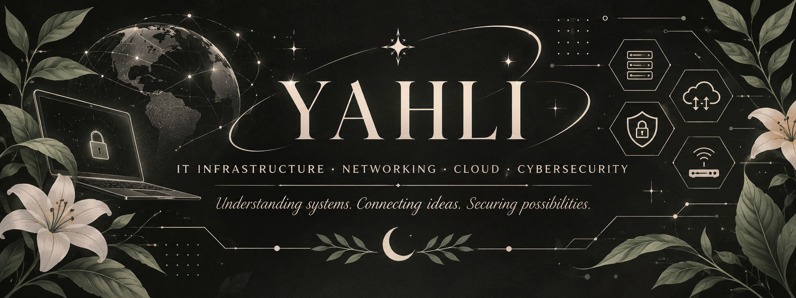

  

<h1 align="center">Hi, I'm Yahli 👋</h1>

<h3 align="center">
  IT Infrastructure · Networking · Cloud · Cybersecurity
</h3>

  <i>Understanding systems. Connecting ideas. Securing possibilities.</i>

---

## About Me

I'm an aspiring IT professional interested in understanding how technology works behind the scenes.

My background in customer service, administration and operational processes has helped me develop communication, problem-solving and analytical skills.

I'm currently building my technical foundations in IT infrastructure, networking, systems and cybersecurity, with a strong interest in learning through practical projects and hands-on labs.

- 🎓 Cisco Certified Support Technician (CCST) Cybersecurity
- 🌱 Currently part of Mujer Digital México | Junior Achievement Americas
- 🧩 Interested in IT Support, Networking and Infrastructure
- 🔍 Learning by exploring, testing and solving problems

---

## Current Focus

| Area | What I'm exploring |
|---|---|
| IT Support | Troubleshooting and technical support fundamentals |
| Networking | IPv4, IPv6, subnetting and network design |
| Systems | Operating systems and Linux fundamentals |
| Cloud | Cloud infrastructure and service models |
| Cybersecurity | Network security and security fundamentals |

---

## Certifications & Education

🏅 **Cisco Certified Support Technician (CCST) Cybersecurity**  
Cisco Networking Academy

📚 **Mujer Digital México | Junior Achievement Americas**  
Currently in progress

---

## Projects

### 🌿 Repostería Lequil Yotan

My first web development project, created during my Technical Skills class with Profe Panda.

A creative website inspired by my own baking project and its natural, artisanal identity.

---

## Beyond Technology

I enjoy exploring the connections between technology, creativity and the natural world.

I'm especially curious about how digital infrastructure can evolve while becoming more conscious of its environmental impact.

---

  <i>Curiosity builds knowledge. Practice turns it into experience.</i>

